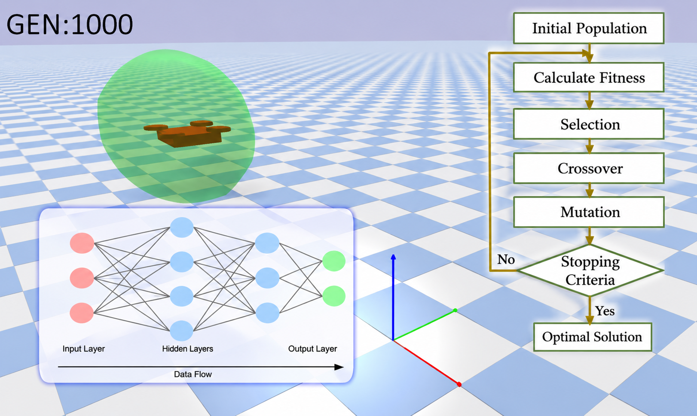

# PID Drone V2 — neuroevolution on top of a classical controller

A quadrotor in PyBullet that flies to a target and holds station there. A small
neural network decides **where to accelerate**; a fixed PID handles everything
below that. The network's weights are found by a genetic algorithm — no
gradients, no backpropagation.

The evolved network reaches targets **18% cheaper and roughly 40% faster** than
the hand-tuned PID it sits on top of.

---


## Files

| File | What it is |
|---|---|
| `droneV2.py` | The drone: physics, graphics, and a standard cascaded PID. Knows nothing about GAs or networks. Run it to watch the PID fly. |
| `GeneticAlgoDrone.py` | The network and the genetic algorithm. Imports `droneV2`. Run it to train, resume, or watch the trained net. |
| `best_genome.json` | The trained network — 83 weights. See below. |
| `best_genome old.json` | An earlier, worse genome, kept for comparison. See below. |
| `convergence.png` | Best and median cost per generation from the last run. |

`droneV2.py` has no dependency on `GeneticAlgoDrone.py`, deliberately. The drone is a drone;
the network is one of several things that could steer it.

---

## Running it

```bash
python droneV2.py        # the drone flown by the hand-tuned PID
python -u GeneticAlgoDrone.py        # train / resume / watch, depending on the dials
```

Use `-u` when training. Python buffers output when it isn't a terminal, so
without it a long run prints nothing and looks like it has hung.

### The dials, at the top of `GeneticAlgoDrone.py`

```python
TRAIN  = True      # False -> skip training, just fly best_genome.json
RESUME = False     # True  -> carry on from best_genome.json instead of
                   #          starting from random
WATCH  = True      # fly the whole population at once in a window
```

| `TRAIN` | `RESUME` | What happens |
|---|---|---|
| `True` | `False` | Evolve from scratch, then watch the winner |
| `True` | `True` | Continue training from `best_genome.json` |
| `False` | — | Skip training, just fly the saved network |

With `WATCH = True` the whole population flies simultaneously in one window,
elites in green. It is a good way to see selection working, but it adds real
time to a run — train headless and watch afterwards.

---

## How it works

```
   target position
        |                     <- the NETWORK does this (6 in -> 3 out)
        v
   desired acceleration (ax, ay, az)
        |   accel_to_tilt     a quadrotor cannot push sideways, so it LEANS.
        v                     small angles: tilt = acceleration / g
   desired roll / pitch / vertical acceleration
        |   attitude_pid      hold that lean (fixed gains, never evolved)
        v
   thrust + roll/pitch/yaw torques
        |   mix               share across four rotors
        v
   four rotor thrusts
```

The network replaces exactly one function — `droneV2.position_pid`. It answers
a single question: *which way, and how hard, should I accelerate?*

### Why there is a PID underneath

A quadrotor is **actively unstable** — mathematically an inverted pendulum.
Measured on this body, it tips 60° in 0.086 s, and 20 out of 20 random networks
commanding raw motor thrusts flipped within 0.15 s. Every individual then scores
identically awful and evolution has a flat landscape with nothing to climb.
Heavier inertia, motor lag and air damping were all tried; none kept a single
random net alive, because passive measures change how *fast* it falls over, not
*whether* it does.

So the inner PID is not a shortcut, it is the minimum physics required. The
network still decides everything that is actually the task.

---

## The network

**6 → 8 → 3, fully connected, feedforward, `tanh`. 83 weights.**

### Inputs (6)

| # | Value | Scaling |
|---|---|---|
| 0–2 | `target − position` | ÷ 5 |
| 3–5 | `velocity` | ÷ 5 |

Position **error**, never absolute position — absolute position teaches one
memorised route, the error teaches "the target is that way". The ÷ 5 keeps
inputs near [−1, 1]; raw metres saturate `tanh` immediately and the network
collapses into a constant.

It never sees roll, pitch, yaw or angular velocity. Attitude is the PID's job.

### Outputs (3)

`ax`, `ay`, `az` — desired acceleration, each scaled to ±5 m/s².

`tanh` doubles as a safety clamp: the network *physically cannot* command more
than that, whatever its weights. And because gravity is cancelled as
feedforward, **zero output is an exact hover** — so a random generation-0
network floats rather than dropping, which is what gives evolution something to
measure from the very first generation.

### Layers

| Layer | Size | Parameters |
|---|---|---|
| input | 6 | 0 |
| hidden | 8 | 56 (48 weights + 8 biases) |
| output | 3 | 27 (24 weights + 3 biases) |
| | | **83 = the genome** |

---

## The genetic algorithm

| Setting | Value | Why |
|---|---|---|
| `POP_SIZE` | 40 | candidates per generation |
| `TOURNAMENT_K` | 3 | pick 3 at random, best becomes a parent. Good genomes are likely to breed but not guaranteed, which preserves variety |
| `N_ELITES` | 2 | top 2 copied untouched, so `best` can never get worse |
| `P_CROSSOVER` | 0.7 | 70% of children are the average of two parents; the other 30% are a mutated clone |
| `P_MUTATE` | 0.2 | 20% of genes nudged per child — about 17 of 83 |
| `SIGMA` | 0.15 | size of that nudge, on a [0,1] gene range |
| `SIGMA_DECAY` | 0.98 | explore early, polish late |
| `SIGMA_MIN` | 0.02 | **floor.** 0.98 compounds to 0.002 by generation 226 — mutation dies and the search silently freezes |

Mutation is the only source of genuinely new values; selection and crossover can
only reshuffle what the population already contains.

### Fitness

One flight produces one number. Lower is better, all terms added, each
normalised by the start-to-target distance so near and far targets are
comparable.

| Term | Weight | Charges for |
|---|---|---|
| `arrive_xy` | 20 | horizontal distance left at the end |
| `arrive_z` | 15 | vertical distance left — **separate**, so ignoring altitude cannot be discounted |
| `path` | 10 | average distance during the flight — the dense signal |
| `progress` | 25 | the closest it ever got |
| `hold` | 25 | settling inside the target and **staying** |
| `upright` | 10 | fraction of the flight spent flatter than 10° |
| `stop` | 5 | still moving at the end |
| `overshoot` | 5 | drifting back out after the closest approach |
| `time` | 5 | how long until the hold completed |

**The hold is the actual task.** Inside 0.3 m, under 0.3 m/s, flatter than 5°,
for 1.5 unbroken seconds. Touching the target is not completing it — without
this, the best strategy is to fling itself at the target and sail through.

**There is no crash penalty and nothing resets.** A drone that hits the ground
stays in the episode and simply never completes the hold. The clock is the only
limit: 1920 steps, 8 seconds, identical for every genome.

Each genome is scored on **four different routes** (varying direction, distance,
climb and descent) and averaged. Training on a single route teaches a memorised
trajectory — in an earlier version that showed up as a network which ignored
altitude entirely, because with one target the z-error input never varied.

---

## Results

Scored through the identical measuring loop:

| | cost |
|---|---|
| **Evolved network** | **4.79** |
| Hand-tuned PID | 5.86 |
| Do-nothing network (zero weights, hovers) | 100 |
| Random networks | ~350 median |

Behaviour on the four training targets:

| | network | hand-tuned PID |
|---|---|---|
| final error | **9 mm** | 11–14 mm |
| time to arrive and hold | **1.6–2.3 s** | 3.5–3.8 s |
| held station | all four | all four |

On five targets it had never trained on: **9 mm, held, every one.** It learned a
policy rather than a route — which is what feeding it the error vector rather
than absolute position was for.

The likely reason it beats a fixed PID: `tanh` lets it push hard when far away
and ease off when close. That is gain scheduling, discovered rather than
designed.

---

## The two genome files

Both hold 83 numbers in `[0, 1]` plus the cost they achieved:

```json
{ "cost": 4.793, "genome": [0.51, 0.08, "..."] }
```

`GeneticAlgoDrone.make_net()` unpacks that list into the network's two weight matrices and
two bias vectors. The genome **is** the network.

| File | Cost | What it is |
|---|---|---|
| `best_genome.json` | **4.79** | The current best. Loaded automatically by `TRAIN = False` and by `RESUME = True`. Beats the hand-tuned PID. |
| `best_genome old.json` | 6.26 | An earlier run, kept as a reference point. Nothing loads it automatically. |

Both were re-scored against the current fitness function and matched their saved
values exactly, so the two numbers are directly comparable.

**Training overwrites `best_genome.json`.** Rename anything you want to keep
before starting a run — which is exactly what the "old" file is.

`GeneticAlgoDrone.py` checks the gene count on load, so a genome saved under a different
architecture is reported as out of date rather than failing with a confusing
reshape error.

> Repository note: `best_genome old.json` has a space in its name, which is
> awkward on the command line and in URLs. `best_genome_v1.json` would be
> friendlier.

---

## Requirements

```bash
pip install pybullet numpy matplotlib
```

`matplotlib` is optional — it is only used to save the convergence plot, and
training skips it cleanly if it is missing.
